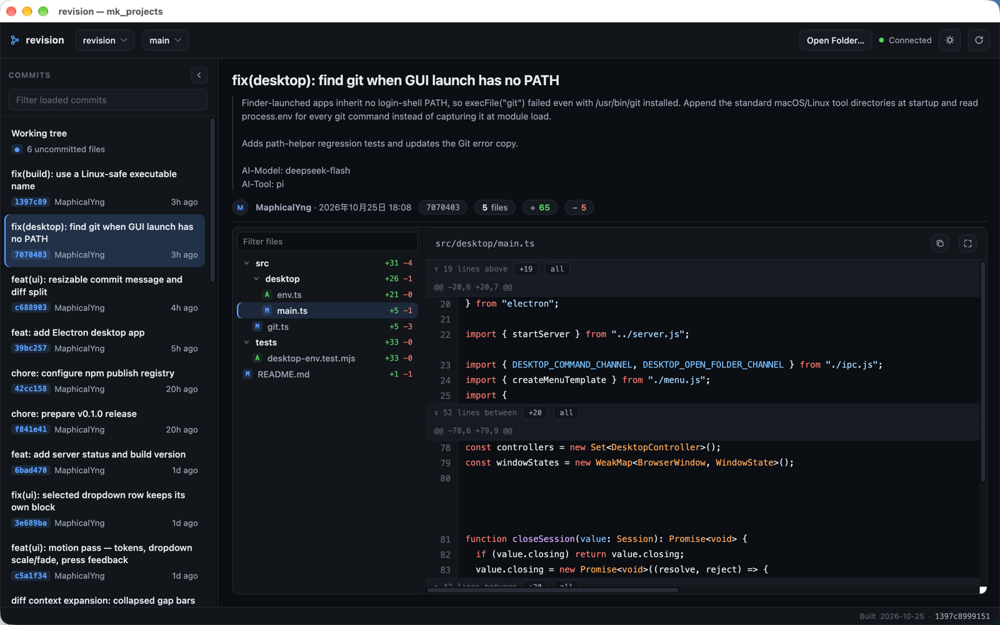

# revision

English | [简体中文](README.zh-CN.md)

A zero-dependency web UI for browsing local git repositories: branches, commit history, and **side-by-side commit diffs with aligned line numbers** — old on the left, new on the right, every row numbered on both sides, with word-level highlights on changed tokens.



Visual reference: [Linear](https://linear.app)-style dark UI, [GitHub Dark](https://github.com)-style diff colors.

```
┌──────────────────────────────────────────────────────────────┐
│ ⎇ revision   [alpha ▾]  [main ▾]                      ⟳     │
├──────────────┬───────────────────────────────────────────────┤
│ Commits      │  refactor server, add util + assets           │
│  filter…     │  Demo Dev · Oct 1, 2026 · a1b2c3d · 5 files  │
│ ──────────── │ ┌ src/server.ts │A src/util.ts │R docs/… ┐    │
│ ● a1b2c3 v2… │ ├───────────────────────────────────────────┤ │
│ ○ 9f8e7d …   │ │  @@ -1,5 +1,6 @@                            │ │
│ ○ 3c4d5e …   │ │   1  import http…   │ 1  import http…       │ │
│ ○ 7a6b5c …   │ │   2                 │ 2  import { readFi…   │ │
│ ○ 1f2e3d …   │ │   3  const server…  │ 3  const server…      │ │
│ [Load more]  │ │   4    res.writ…    │ 4 -  res.end('hello…  │ │
│              │ │   5                 │ 5 +  res.end('hello…  │ │
│              │ │   6  });            │ 6  });                │ │
│              │ └───────────────────────────────────────────┘ │
└──────────────┴───────────────────────────────────────────────┘
```

## Install

### npm (CLI / Web)

Requires Node.js >=18 and Git on `PATH`.

```bash
npm install -g @maphicalyng/revision
```

Or run straight away with npx (compiles on demand are not needed — the published package ships plain JS):

```bash
npx @maphicalyng/revision ~/code
```

### Homebrew (desktop app)

The desktop app is available as a Cask for macOS (Apple Silicon and Intel) and Linux (x86_64). It does not require Node.js, and the Cask installs Git as a dependency.

Add the tap once:

```bash
brew tap MaphicalYng/tap
```

On macOS:

```bash
brew install --cask MaphicalYng/tap/revision
```

The app is not currently signed with an Apple Developer certificate. If macOS prevents it from opening, and you trust this release, remove the quarantine attribute from this app only:

```bash
xattr -dr com.apple.quarantine /Applications/revision.app
```

On Linux (x86_64):

```bash
brew install --cask MaphicalYng/tap/revision
```

## Usage

```bash
revision [dir]            # serve repos under `dir` (default: cwd)
  -p, --port <n>          # default 4777; walks up to +20 if the port is busy
  --host <ip>             # default 127.0.0.1; use 0.0.0.0 for LAN access
  --token <secret>        # access token (default: random token, printed at startup)
  --no-auth               # disable token authentication (loopback only!)
  --no-open               # do not open the browser
  -v, --version           # print the package version
  -h, --help              # print usage
```

**Token authentication is on by default.** Every start generates a random token and prints a ready-to-use URL:

```
revision ~/code
  listen  : http://127.0.0.1:4777/?token=GgY9rM3xQ8wK2vZpL7sN4tRf
```

The page carries `?token=` in its URL and forwards it as an `Authorization: Bearer` header on every API call; API clients can pass either form. Without a valid token the server answers `401` for both the page and the API. Comparison is constant-time. Pass `--token <secret>` to choose your own (handy for bookmarks or multiple clients), or `--no-auth` only when the bind address is loopback / behind your own reverse-proxy auth.

`dir` itself shows up when it is a git repository (so `revision ~/code/app` works), and so does every immediate subdirectory of `dir` that contains a `.git` entry. Click a commit on the left, select files in the tree beside the diff, and read the diff.

The desktop app is an additional way to run the same UI. The CLI/Web workflow remains available: port 4777 is still the default, and `revision` still opens your browser unless `--no-open` is passed.

### Keyboard

| Key | Action |
| --- | --- |
| `j` / `k` | next / previous commit in the list |

## Desktop

The desktop build is a standalone application for each platform:

| Platform | Package |
| --- | --- |
| macOS | DMG containing a `.app`, arm64 and x64 |
| Windows | NSIS installer, x64 |
| Linux | AppImage, x64 |

Launch the app directly: Electron/Chromium and the Node runtime are included, so no system Node.js, npm, terminal, or external browser is needed. **Git is not bundled.** Install Git separately. The app searches `PATH` plus the standard install locations (`/usr/bin`, `/opt/homebrew/bin`, `/usr/local/bin`, and `/snap/bin` on Linux). If Git is missing or cannot run, the app shows a native error with **Retry**.

### Manual macOS DMG installation

For a manual DMG installation, the released DMGs are unsigned and not notarized, so macOS may prevent the downloaded app from opening. After opening the DMG and copying `revision.app` to `/Applications`, remove its quarantine attribute:

```bash
xattr -dr com.apple.quarantine /Applications/revision.app
```

Then launch revision normally. Only run this command for an app you trust.

On first launch the app shows a welcome screen instead of opening a repository automatically. Choose a Git repository or a folder whose direct subfolders are repositories; later launches restore the last successfully opened folder. **Open Folder…** uses the native directory picker, and **Open Recent** keeps up to 10 folders and includes **Clear Recent**. Folder discovery is the same as the CLI: the selected folder itself is included when it is a git repository, as are its direct subdirectories containing a `.git` entry. Switching folders does not ask for confirmation.

### Desktop keyboard shortcuts

| Action | macOS | Windows / Linux |
| --- | --- | --- |
| Open Folder… | `⌘O` | `Ctrl+O` |
| Refresh data (not a full-page reload) | `⌘R` | `Ctrl+R` |
| Toggle Commit List | `⌘B` | `Ctrl+B` |
| Filter Commits | `⌘F` | `Ctrl+F` |
| Filter Changed Files | `⇧⌘F` | `Ctrl+Shift+F` |
| Next / previous commit | `j` / `k` | `j` / `k` |
| Close / Quit | `⌘W` / `⌘Q` | System standard |
| Undo, redo, cut, copy, paste, select all | System standard | System standard |

### Window and layout

Window size, position, and maximized state, the light/dark theme, the commit-list collapsed state, and both pane widths persist across launches. The commit-message separator starts fitted to the selected commit's message, so switching commits re-fits it. Drag the separator or focus it and use the up/down arrow keys to override the height for the current commit; double-click it to fit the message again.

| Pane | Adjustable size | Default |
| --- | --- | --- |
| Commit list | 240–420 px wide | 320 px |
| Changed-file tree | 200–380 px wide | 264 px |
| Commit message | 88 px to available height | Fits content; long message bodies scroll at 26vh |

### Building desktop packages

```bash
npm run dev:desktop   # build and launch the Electron app
npm run dist:desktop  # build local packages without publishing
```

Packages are written to `release/`. Unsigned local packages can be used for verification. Public distribution requires Apple code signing and notarization for macOS and code signing for Windows; signing credentials are not included in this repository. Windows and Linux packages have not been verified on this machine.

## Features

- **Repo discovery** — the target directory itself when it is a repo, plus one level deep, worktrees and submodules included (a `.git` file or dir), name collisions suffixed, 100-repo cap; rescan on every browser refresh
- **Branches** — local branches with the current one preselected; remote branches under an optgroup; pull the selected checked-out local branch from the header, with start and completion toasts
- **Searchable dropdowns** — repository and branch pickers are custom dropdowns (no native `<select>`) with type-to-filter, keyboard navigation (↑↓ Enter Esc), grouped branch list (Local/Remote), and current-selection marking
- **File tree search** — a filter box atop the file tree narrows to matching paths (flattened full-path view) as you type
- **Commit list** — collapsible sidebar (preference remembered), paged 100 at a time with "Load more", server-side full-history search (matches subject, author name or email, and SHA — short or full 40-char, any prefix length), merge-commit markers, relative timestamps
- **File tree** — changed files rendered as an expandable directory tree beside the diff (not a tab strip), with per-file and per-directory `+x −y` counts and `A`/`M`/`D`/`R`/`U` status badges; the chain to the selected file auto-expands, everything else starts collapsed
- **Working tree** — a “Working tree” entry atop the commit list shows uncommitted changes (staged + unstaged combined, diffed against HEAD); rename-aware file statuses, per-file `+x −y` from numstat, untracked files rendered as all-new-line diffs with `U` badges on files and fully untracked directories, unborn-branch support; untracked files can be permanently deleted from the diff header after an in-app confirmation
- **Commit detail** — full message body, author, exact date, copyable SHA and file paths, aggregate `files changed / +ins / −del` stats
- **Side-by-side diff** — the old file on the left, the new file on the right, each with its own line numbers; deletion/addition runs pair row-by-row so both columns stay aligned; unpaired leftovers render with an empty opposite cell
- **Syntax highlighting** — diff rows are highlighted per file extension (32 extension-mapped languages from the vendored 37-language [highlight.js](https://highlightjs.org) common bundle — no CDN, no extra dependency, still one self-contained HTML page); GitHub-light/dark token palettes that follow the theme toggle; word-level change marks overlay the highlighted line so strings and comments spanning a change keep their colors; files above 5000 diff rows skip highlighting to stay fast
- **Word-level highlights** — paired changed lines are split into common-prefix / changed-middle / common-suffix token spans so only what actually changed lights up
- **Hunk headers** — `@@ -a,b +c,d @@` separators between change blocks
- **Collapsible context** — the space above, between, and below hunks renders as slim bars (`↑ 46 lines above [+20] [all]`); `+20` reveals twenty more lines toward the diff, middle gaps grow 10 lines per edge, `all` opens the whole region; a corners button in the diff header expands the **entire file** (and collapses back). Expansion is surgical DOM insertion — no re-render, scroll position never jumps; revealed rows reuse the same syntax highlighting with the 5000-row budget shared across hunk and revealed rows
- **Binary & oversized files** — detected and shown as notices instead of hanging the page (diffs above ~1.5 MB are refused with a copy-pasteable `git diff` command); files over 1,000,000 bytes still show hunks, but collapsed-context and whole-file expansion are unavailable
- **Merge commits** — diff computed against the first parent, with a note in the header
- **Root commits** — handled via `git diff-tree --root` / `git show`
- **Hash routing** — `#r=<repo>&b=<branch>&c=<sha>` is synced as you navigate, so repository, branch, and commit navigation is shareable/bookmarkable
- **Security** — token authentication on by default (random token per start, printed as a ready URL; `--token` to fix your own, `--no-auth` to opt out); constant-time comparison; repo ids come from a discovery scan, never raw paths; revisions validated as hex; file paths validated as repo-relative; all git calls use argument arrays (no shell); `GIT_OPTIONAL_LOCKS=0` keeps reads from touching the index lock; localhost binding by default
- **Server status & build version** — the header shows connected/disconnected state using an authenticated 10-second health check plus browser network events; the footer shows the tool's build date and source Commit ID, embedded at build time so npm installs do not need the tool's `.git` directory

## Architecture

The CLI/Web UI has zero runtime npm dependencies: Node >= 18, plain `node:http`, TypeScript compiled to `dist/`.

```
src/
  cli.ts      argument parsing, browser launch
  server.ts   http server, routing, input validation, JSON API
  git.ts      safe argument-array wrappers around the git CLI
  diff.ts     unified-diff parser + side-by-side row pairing + word spans
  page.ts     the single-page UI (inline CSS/JS, no build step)
  hljs.ts     vendored highlight.js v11.11.1 (common bundle), inlined into the page
  desktop/
    main.ts    Electron lifecycle, native folder sessions, and window state
    preload.cts  sandboxed contextBridge API and desktop command subscription
    menu.ts    native menus, recent folders, and shortcuts
    settings.ts  persisted recent folders and window placement
    env.ts     GUI PATH augmentation for Git discovery
    ipc.ts     IPC channel names shared by main and preload
    welcome.ts first-run welcome page
bin/
  revision.js  npm bin wrapper -> dist/cli.js
scripts/
  demo.mjs     generates sample repos under /tmp/revision-demo
  build-version.mjs  embeds the build date and tool Commit ID into src/build-info.ts
tests/
  *.test.mjs  desktop menu/settings/page contracts and server port behavior
```

Data flow:

```
page --GET /api/repos----------------> server --fs scan------------> repo list
page --GET /api/repo/:id/branches----> server --git branch---------> local + remote branches
page --POST /api/repo/:id/pull?branch-> server --git pull----------> checked-out local branch update
page --GET /api/health----------------> server (authenticated liveness check)
page --GET /api/repo/:id/log?branch--> server --git log------------> commit rows
page --GET /api/repo/:id/commit/:sha-> server --git diff-tree/show-> file list + stats
page --GET /api/repo/:id/work--------> server --git status/diff-----> working-tree files + stats
page --DELETE .../work/untracked?file-> server --git clean----------> confirmed untracked-file deletion
page --GET .../diff?file=------------> server --git diff + parse---> { hunks: [{ rows }] }
page --GET .../work/diff?file=-------> server --git diff + parse---> working-tree hunks
page --GET .../file?file=-------------> server --git cat-file/fs read--> { old, new } full texts (powers collapsed context)
page --GET .../work/file?file=-------> server --git show/fs read------> working-tree full texts
page renders rows in a 4-column grid: [old #][old code][new #][new code]
```

Line-number alignment is a pairing problem, not a rendering problem: within each hunk, context rows carry both numbers, buffered deletions pair row-by-row with the following additions, and leftovers stay unpaired with an empty opposite cell. The result is two columns that always line up row for row.

## Development

```bash
npm install
npm run build          # embed build date + Commit ID, then tsc -> dist/
npm run demo           # create sample repos in /tmp/revision-demo
node bin/revision.js /tmp/revision-demo
```

## License

MIT
